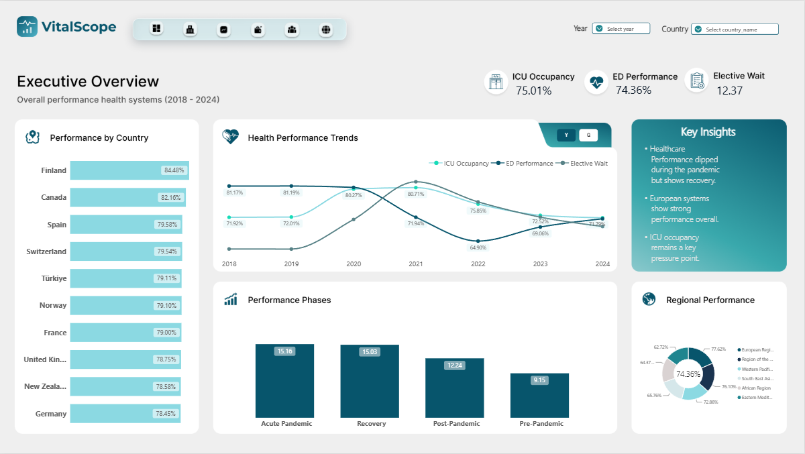
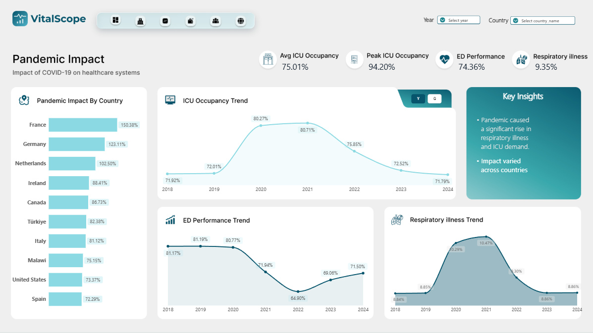
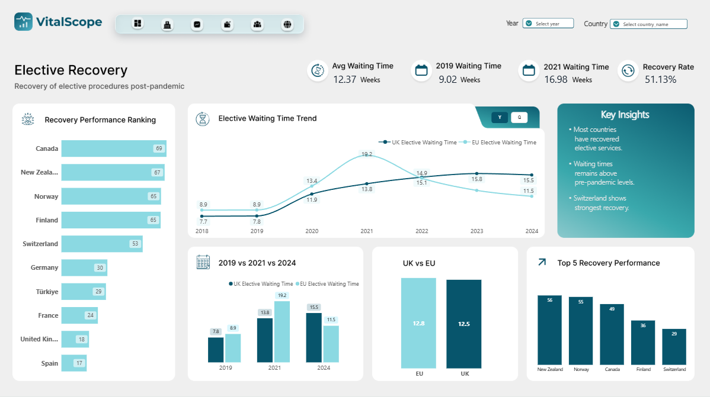
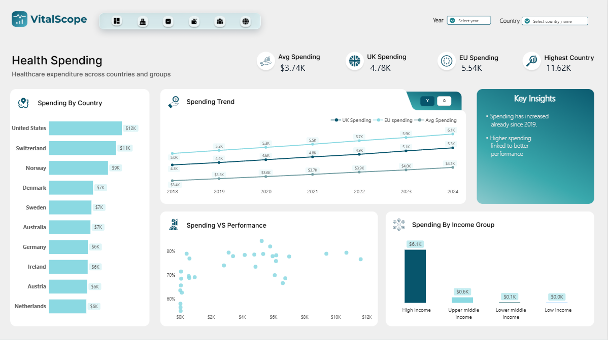
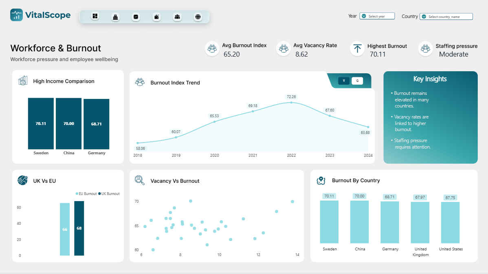
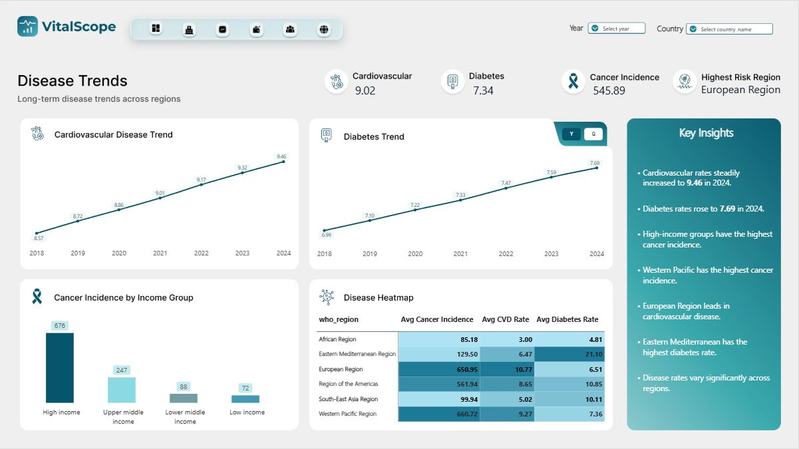

# Health-System-Performance-Analytics-Dashboard
An interactive healthcare analytics project developed for the November 2026 Onyx DataDNA Challenge.

This project analyzes health system performance across 32 countries from 2018 to 2024 through six interactive dashboard sections:

1. Executive Overview: Overall healthcare system performance, key performance indicators, and country comparisons.
2. Pandemic Impact: COVID-19 impact on healthcare systems, ICU occupancy, ED performance, and respiratory illness.
3. Elective Recovery: Monitoring healthcare spending and performance trends throughout different recovery phases.
4. Health Spending: Healthcare expenditure comparisons across countries and income groups.
5. Workforce & Burnout: Staff burnout levels, vacancy rates, and workforce pressure.
6. Disease Trends: Cardiovascular disease, diabetes, and cancer incidence patterns.

The project transforms healthcare data into interactive visualizations and meaningful insights to support data exploration, performance monitoring, and evidence-based decision-making.

Dataset: Onyx DataDNA – November 2026 Challenge
Period: 2018–2024
Coverage: 32 countries

# Dashboard Preview

### Executive Overview

### Pandemic Impact

### Elective Recovery

### Health Spending

### Workforce & Burnout

### Disease Trends

